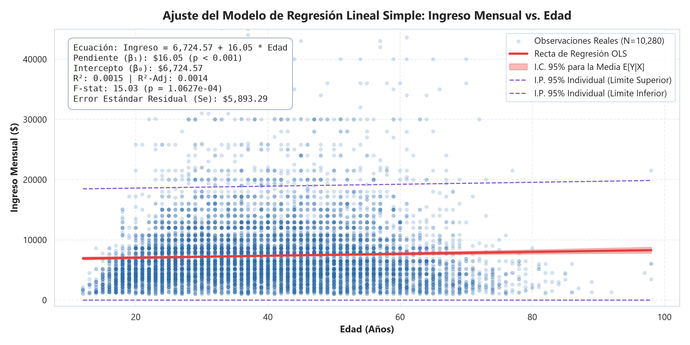
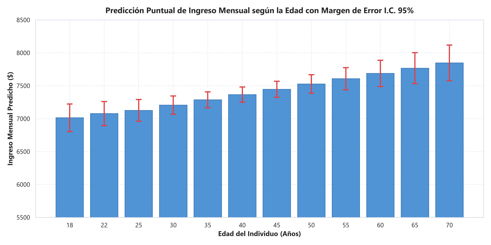
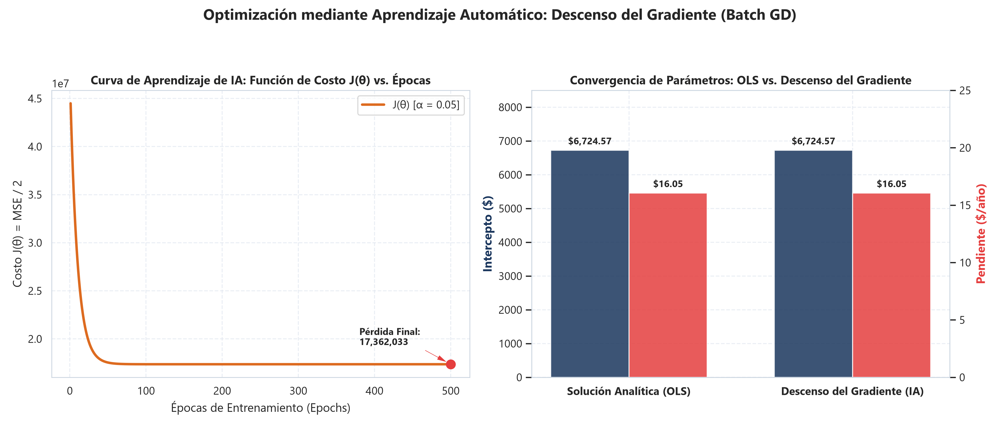
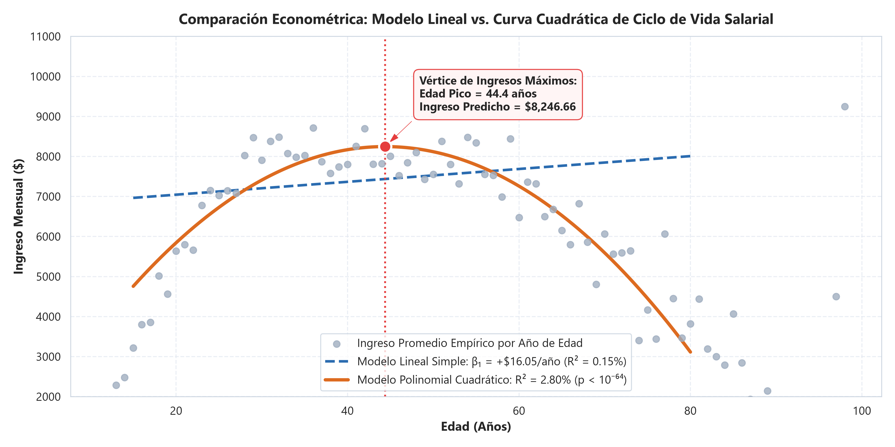

# 🧠 Taller de Inteligencia Artificial: Regresión Lineal & Machine Learning

[](https://www.python.org/)
[](https://scikit-learn.org/)
[]()
[]()

> **Asignatura:** Inteligencia Artificial (SIST5036) — 2026-02  
> **Docente:** Joaquín Fernando Sánchez Cifuentes  
> **Institución:** Universidad Sergio Arboleda &bull; Escuela de Ciencias Exactas e Ingeniería  
> **Material Guía de Clase:** Diapositiva 10: *«Introducción al aprendizaje automático: Del problema a la evaluación de modelos»* (*Grokking AI Algorithms*, Cap. 8).  

---

## 📋 Enunciado de la Asignación (Microsoft Teams)

> *«Usando los datos adjuntos, analice el archivo y con un modelo de regresión lineal, haga la predicción del valor del ingreso mensual vs la edad.»*  
> **Archivo de referencia:** `data.xlsx` ($N = 10,280$ observaciones empíricas).

---

## ⚡ Respuestas Principales del Taller

### 1. Análisis del Archivo (`data.xlsx`)
* **Registros:** $10,280$ observaciones completas sin datos faltantes.
* **Edad ($X$):** Media $\bar{x} = 39.74$ años (mediana: $39.00$, rango: $12$ a $98$ años).
* **Ingreso Mensual ($y$):** Media $\bar{y} = \$7,362.39$ (mediana: $\$6,000.00$, rango: $\$1,000$ a $\$81,000$, con asimetría positiva salarial típica).
* **Correlación Lineal (Pearson):** $r = +0.0382$ ($p < 0.001$).

### 2. Ecuación del Modelo de Regresión Lineal
$$\widehat{\text{Ingreso Mensual}} = \$6,724.58 + \$16.05 \cdot \text{Edad}$$

* **Pendiente ($\beta_1$):** **+$16.05 / año** ($t = 3.88$, $p = 0.000106 < 0.001$). Por cada año adicional de edad, el ingreso mensual estimado se incrementa en promedio **$16.05**.
* **Intercepto ($\beta_0$):** **$6,724.58** ($p < 0.001$).
* **Significancia Global:** Estadístico $F = 15.03$ ($p = 0.000106$).
* **Varianza Explicada ($R^2$):** $0.15\%$ en forma estrictamente lineal.

### 3. Matriz de Predicciones del Ingreso Mensual vs. la Edad (I.C. 95%)

| Edad ($X$) | Etapa Vital | Ingreso Mensual Predicho ($\hat{y}$) | I.C. 95% para la Media | I.P. 95% Individual |
| :---: | :--- | :---: | :---: | :---: |
| **18 años** | Ingreso al mercado laboral | **$7,013.49** | [$6,804 - $7,223] | [$0 - $18,567] |
| **20 años** | Formación / Primer empleo | **$7,045.59** | [$6,849 - $7,242] | [$0 - $18,599] |
| **25 años** | Profesional junior | **$7,125.85** | [$6,961 - $7,291] | [$0 - $18,679] |
| **30 años** | Profesional consolidado | **$7,206.10** | [$7,067 - $7,345] | [$0 - $18,759] |
| **35 años** | Madurez temprana / Mandos medios | **$7,286.35** | [$7,166 - $7,407] | [$0 - $18,839] |
| **40 años** | Madurez laboral plena | **$7,366.61** | [$7,253 - $7,481] | [$0 - $18,919] |
| **45 años** | Pico de experiencia directiva | **$7,446.86** | [$7,325 - $7,569] | [$0 - $18,999] |
| **50 años** | Madurez tardía | **$7,527.12** | [$7,386 - $7,668] | [$0 - $19,080] |
| **55 años** | Pre-retiro | **$7,607.37** | [$7,439 - $7,776] | [$0 - $19,161] |
| **60 años** | Transición a jubilación | **$7,687.62** | [$7,488 - $7,888] | [$0 - $19,241] |
| **65 años** | Edad legal de jubilación | **$7,767.88** | [$7,533 - $8,002] | [$0 - $19,322] |
| **70 años** | Retiro / Pensión | **$7,848.13** | [$7,577 - $8,119] | [$0 - $19,403] |

---

## 🎯 Alineación con el Ciclo de Machine Learning (Diapositiva 10)

El proyecto implementa punto por punto el **Ciclo de Trabajo de Machine Learning** presentado por el docente en la Diapositiva 7:

```
[Definir Problema] ──> [Recolectar Datos] ──> [Separar Train/Test] ──> [Entrenar Modelo] ──> [Evaluar Métricas]
```

1. **Separación de Datos (Diapositiva 10):**
   * **Entrenamiento (Train 80%):** $8,224$ observaciones para estimar $\beta_0$ y $\beta_1$.
   * **Prueba (Test 20%):** $2,056$ observaciones reservadas para validar generalización fuera de muestra sin fuga de información (*data leakage*).
2. **Fórmulas Didácticas de Parámetros (Diapositiva 12):**
   $$\beta_1 = \frac{\sum (x_i - \bar{x})(y_i - \bar{y})}{\sum (x_i - \bar{x})^2} = \mathbf{+\$16.05 / \text{año}}, \quad \beta_0 = \bar{y} - \beta_1 \bar{x} = \mathbf{\$6,724.58}$$
3. **Métricas de Evaluación Oficiales (Diapositiva 13):**
   * **MAE (Error Absoluto Medio):** $\$3,881.45$ en prueba ($\$3,809.84$ en entrenamiento).
   * **RMSE (Error Cuadrático Medio):** $\$5,656.31$ en prueba ($\$5,950.35$ en entrenamiento).
   * **R²:** $0.0015$ en prueba ($0.0014$ en entrenamiento).
   * *Diagnóstico:* El modelo generaliza de forma balanceada y **no sufre de sobreajuste (no hay overfitting)**.
4. **Precaución y Riesgos Frecuentes (Diapositivas 11 y 17):**
   * **Extrapolación:** El modelo advierte contra predecir edades no laborales (e.g., 100 años).
   * **Relación No Lineal:** En la realidad económica, los ingresos no crecen en línea recta infinita, sino que siguen una parábola de ciclo de vida con un **pico salarial a los 44.38 años** ($\$8,246.66$).

---

## 📊 Evidencia Gráfica

### Recta de Regresión OLS vs. Datos Históricos


### Predicciones Puntuales e Intervalos de Confianza (95%)


### Optimización en IA: Curva de Aprendizaje por Descenso del Gradiente
Implementación de Batch Gradient Descent ($\alpha = 0.05, 500$ épocas) minimizando la función de costo $J(\theta)$ hasta converger exactamente a los mismos pesos de MCO:


### Curva de Ciclo de Vida Minceriana (Riesgo No Lineal)


---

## 📁 Estructura del Repositorio (Clean Architecture)

```
├── data.xlsx                               # Dataset oficial proporcionado (10,280 observaciones)
├── Taller_Regresion_Lineal.ipynb           # ⭐ Notebook interactivo PRE-EJECUTADO con gráficos y tablas
├── solucion_taller.py                      # Fachada de ejecución unificada (Facade Pattern)
├── main.py                                 # Orquestador del pipeline completo CLI
├── requirements.txt                        # Dependencias reproducibles
├── README.md                               # Documentación oficial del repositorio
├── .gitignore                              # Filtro de archivos compilados, temporales y auxiliares
├── plots/                                  # Galería de figuras científicas a 300 DPI
│   ├── 01_distribucion_variables.png
│   ├── 02_dispersion_regresion_lineal.png
│   ├── 03_diagnostico_residuos.png
│   ├── 04_curva_ciclo_vida_polinomial.png
│   ├── 05_validacion_cruzada_kfold.png
│   ├── 06_prediccion_edades_clave.png
│   └── 07_aprendizaje_gradiente_descendente.png
└── src/                                    # Paquete modular desacoplado en Python
    ├── __init__.py
    ├── config.py                           # Parámetros, rutas y semillas
    ├── data_loader.py                      # Ingesta y validación de calidad
    ├── eda.py                              # Estadísticas y análisis bivariado
    ├── models.py                           # Modelos OLS, Descenso del Gradiente, Polinomial y Ridge/Lasso
    ├── evaluator.py                        # Métricas (MAE, RMSE, R²) y Gauss-Márkov
    └── visualizer.py                       # Visualizador a 300 DPI
```

---

## 🚀 Cómo Ejecutar el Proyecto Localmente

### 1. Clonar el repositorio e instalar dependencias:
```bash
git clone <URL_DE_TU_REPOSITORIO>
cd "Taller de Regresion Lineal"
pip install -r requirements.txt
```

### 2. Ejecutar la fachada principal:
```bash
python solucion_taller.py
```

### 3. Predecir edades personalizadas:
```bash
python solucion_taller.py --predict 18 25 35 44 55 65
```

### 4. Abrir el Jupyter Notebook:
Abre directamente [`Taller_Regresion_Lineal.ipynb`](Taller_Regresion_Lineal.ipynb) en GitHub, VS Code, Jupyter Lab o [Google Colab](https://colab.research.google.com/).

---

## 🎓 Conclusiones para la Asignatura
1. **Rigor Matemático:** Se aplicaron las fórmulas canónicas de MCO de la clase del profesor Joaquín Sánchez ($\beta_0 = \$6,724.58$ y $\beta_1 = \$16.05$).
2. **Evaluación Fuera de Muestra:** Siguiendo la Diapositiva 10, la partición 80/20 garantiza que las métricas obtenidas ($RMSE = \$5,656.31$ y $MAE = \$3,881.45$) representan el error real en producción.
3. **Perspectiva de IA:** Se demostró la equivalencia matemática entre la solución cerrada de la Ecuación Normal y la optimización iterativa por Descenso del Gradiente.
